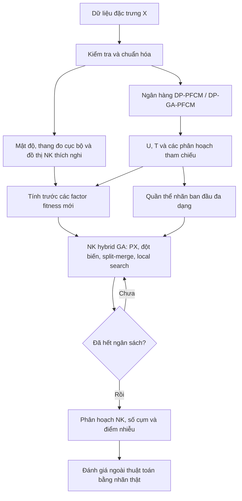

# Kiến trúc nghiên cứu: NK hybrid GA với fitness thích nghi và hướng dẫn fuzzy

## 1. Phạm vi và tên làm việc

**Tên tiếng Việt đề xuất:** Cải tiến NK hybrid GA bằng fitness lân cận thích nghi và thông tin fuzzy để giảm hiện tượng gộp cụm trong dữ liệu chồng lấn.

**Tên tiếng Anh làm việc:** Adaptive Fuzzy-Guided NK Hybrid Genetic Algorithm for Clustering Overlapping Data.

**Tên viết tắt làm việc:** AF-NKGA. Đây là nhãn của thiết kế đang đề xuất, chưa phải thuật toán đã được kiểm chứng hay tên khẳng định tính mới.

Lõi kế thừa là biểu diễn nghiệm bằng vector nhãn, đồ thị tương tác, NKCV2, partition crossover (PX), delta-evaluation, tìm kiếm cục bộ và split-merge của NK hybrid GA. DP-PFCM/DP-GA-PFCM cung cấp nghiệm khởi tạo và thông tin tham chiếu fuzzy. Đóng góp dự kiến nằm ở fitness mới và cách tích hợp giữ được tính phân rã.

Giả thuyết cần kiểm nghiệm: thông tin lân cận ở thang đo cục bộ, kết hợp bằng chứng cùng/khác cụm có độ tin cậy fuzzy, có thể giảm việc gộp cụm mà không làm suy giảm quá mức khả năng phát hiện hình dạng bất kỳ và nhiễu.

Không xem lớp tham chiếu là cấu trúc cụm duy nhất đúng trong mọi bài toán. Điểm biên, cụm nhỏ/thưa và nhiễu là ba trường hợp cần đánh giá riêng.

## 2. Ký hiệu và đầu vào/đầu ra

| Ký hiệu | Ý nghĩa |
|---|---|
| X thuộc R^(N x d) | N điểm với d đặc trưng, không có nhãn thật trong thuật toán |
| z=(z_1,...,z_N) | Nghiệm NK; z_i=0 là nhiễu, z_i>0 là nhãn cụm |
| K | Số điểm khác i trong nhóm NK; không phải số cụm |
| k_s | Số láng giềng dùng để xác định thang đo cục bộ |
| C_ref | Số cụm của một mô hình PFCM tham chiếu |
| C_hat | Số nhãn dương khác nhau trong nghiệm NK cuối |
| U^(r), T^(r) | Membership và typicality của mô hình tham chiếu r |
| E | Tập cạnh có hướng, bỏ self-loop, của các factor cặp |
| lambda | Mức đóng góp của hướng dẫn fuzzy trong fitness |

Đầu vào là X, cấu hình đồ thị, tập C_ref, ngân sách bootstrap và ngân sách NK. Đầu ra là z*, C_hat, tập điểm nhiễu và chẩn đoán. U,T của ngân hàng tham chiếu không tự động trở thành membership fuzzy của phân hoạch NK cuối.

## 3. Luồng tổng thể

Đồ thị, mật độ, scale, U,T và các factor được đóng băng trong toàn bộ một lượt NK ở phiên bản cơ sở. Không chạy lại một GA-PFCM bên trong mỗi lần chấm fitness NK.

## 4. Các mô-đun thuật toán

### M1. Dữ liệu và tiền xử lý

- Chỉ đưa đặc trưng vào X; nhãn thật được chuyển riêng cho bộ đánh giá sau fit.
- Chọn và công bố một quy trình scaling thống nhất. Đánh giá độ nhạy scaling trong thí nghiệm riêng.
- Không tự động xóa điểm biên, điểm mật độ thấp hoặc cụm nhỏ.
- Ghi nguồn, hash, kích thước, số lớp quan sát và phiên bản dữ liệu; xử lý cột hằng và điểm trùng.

### M2. Đồ thị và khoảng cách thích nghi

Tính scale bằng khoảng cách Euclidean đến láng giềng thứ k_s:

sigma_i = max(distance(x_i, NN_ks(i)), epsilon).

Đề xuất thử khoảng cách không thứ nguyên:

d_tilde(i,j) = distance(x_i,x_j) / sqrt(sigma_i sigma_j).

Đây là việc áp dụng ý tưởng local scaling; không phải cơ chế vốn có của NKCV2. Xây đồ thị theo cấu trúc NK: mỗi nhóm gồm chính điểm i, điểm có mật độ cao hơn phù hợp và các láng giềng bổ sung đến kích thước K+1. Khi thử đồ thị thích nghi, lựa chọn láng giềng theo d_tilde; giữ một biến thể dùng đồ thị gốc để ablation.

Trong phiên bản đầu, giữ cách ước lượng mật độ của NK gốc để tránh thay nhiều cơ chế đồng thời. Các ngưỡng khoảng cách c1,c2,c3 được tính lại trên các khoảng cách d_tilde của cạnh bằng quy tắc đã công bố. Không so sánh khoảng cách đã đổi scale với ngưỡng Euclidean cũ. Mật độ, quy tắc xử lý hòa và fallback cho điểm mật độ cực đại phải xác định trước.

Đồ thị luôn được tạo từ X và thông tin đã cố định; không dùng nhãn thật hoặc thay đổi theo từng cá thể GA.

### M3. Ngân hàng mô hình fuzzy

Chạy một tập hữu hạn mô hình tham chiếu với các C_ref và seed được khai báo trước:

1. DP chọn tâm khởi tạo.
2. DP-PFCM cung cấp ngân hàng cơ sở với chi phí thấp hơn.
3. DP-GA-PFCM là nguồn tham chiếu cần kiểm tra giá trị tăng thêm; chạy dưới ngân sách bootstrap riêng, không lồng vào fitness NK.
4. Thu U^(r), T^(r), tâm, nhãn tham chiếu và chi phí tính toán.

Để đánh giá auto-C, không lấy C_ref từ số lớp thật. Có thể xét một tập ứng viên trong khoảng 2..floor(sqrt(N)), nhưng quy tắc chọn tập và giới hạn ngân sách phải được xác định trước đánh giá. Đây là lựa chọn thiết kế, không bảo đảm tìm được C tốt nhất.

Phân bổ tổng trọng số bằng nhau cho từng C_ref, rồi chia đều cho các seed trong cùng C_ref. Nếu số seed khác nhau, một giá trị C_ref không được vô tình có nhiều phiếu hơn. Ngân hàng nhiều C nhỏ có thể gây thiên lệch gộp; nhiều C lớn có thể gây thiên lệch tách, nên phải có sensitivity.

Membership/typicality dùng để tạo evidence cần có cách tính thống nhất giữa các mô hình. Phiên bản cơ sở nên cố định fuzzifier và tham số typicality tham chiếu. Khi tái sử dụng tâm từ GA-PFCM có tham số khác nhau, có thể tính lại U,T dưới cùng bộ tham số tham chiếu để tránh so sánh độ tin cậy ở những thang khác nhau; đây là một lựa chọn cần công bố.

### M4. Bằng chứng cặp có độ tin cậy fuzzy

Để giữ tính bất biến khi đổi tên cụm, không gắn trực tiếp nhãn NK j với cột j của một ma trận U cố định. Thay vào đó chuyển các mô hình fuzzy thành bằng chứng trên từng cạnh.

Với mô hình r, đặt:

- l_i^(r) = argmax_c u_ic^(r).
- m_i^(r) = u_i,top1^(r) - u_i,top2^(r).
- h_i^(r) = m_i^(r) * t_i,l_i^(r)^(r).

Margin nhỏ làm giảm ảnh hưởng của điểm không chắc chắn; typicality thấp làm giảm ảnh hưởng của điểm không phù hợp với cụm được gán. Đây là heuristic độ tin cậy, không phải xác suất đã hiệu chuẩn.

Với trọng số mô hình pi_r >= 0 và tổng pi_r = 1:

a_ij = sum_r pi_r h_i^(r) h_j^(r) I(l_i^(r) = l_j^(r)).

b_ij = sum_r pi_r h_i^(r) h_j^(r) I(l_i^(r) != l_j^(r)).

a_ij là bằng chứng cùng cụm; b_ij là bằng chứng khác cụm. Hai đại lượng đều có thể nhỏ khi tham chiếu không chắc chắn. Không đặt b_ij=1-a_ij, vì thiếu bằng chứng cùng cụm chưa đủ để kết luận khác cụm.

Không cần khớp tên nhãn giữa các mô hình PFCM vì mỗi chỉ báo chỉ so sánh hai điểm trong cùng một mô hình tham chiếu.

### M5. Fitness đề xuất

Giữ alpha_NK,adaptive là factor NKCV2 với khoảng cách/ngưỡng đã thích nghi, gồm cả nhánh noise của NK. Đặt:

F_NK_bar(z) = sum_(j->i in E) alpha_NK,adaptive(z_i,z_j) / S_NK.

S_NK là hằng số dương tính một lần từ dữ liệu. Ví dụ dùng tổng rho_j trên mọi cạnh cộng epsilon khi mỗi factor vẫn nằm trong [0,rho_j]. Không chuẩn hóa theo min/max fitness của quần thể mỗi thế hệ.

Factor fuzzy cho mỗi cạnh:

V_ij(z_i,z_j) = a_ij I(z_i != z_j) + b_ij I(z_i = z_j), nếu z_i,z_j > 0.

V_ij(z_i,z_j) = a_ij + b_ij, nếu ít nhất một nhãn bằng 0.

Nhánh thứ hai tránh việc chuyển điểm sang noise chỉ để né chi phí fuzzy. Vì a,b không âm, chuyển một đầu cạnh từ nhãn dương sang 0 không thể giảm riêng V_ij. Với điểm có typicality thấp, evidence thường nhỏ, nên phí này có thể nhỏ. Điều này cần kiểm chứng; không mặc định nó bảo toàn khả năng phát hiện mọi loại nhiễu.

F_fuzzy_bar(z) = (1 / |E|) sum_(j->i in E) V_ij(z_i,z_j).

Fitness toàn phần cần tối thiểu hóa:

F_new(z) = (1-lambda) F_NK_bar(z) + lambda F_fuzzy_bar(z), với 0 <= lambda < 1.

Đây là công thức ứng viên cụ thể cho prototype. Bản gốc NK không chứa các a,b và V này. Khi lambda=0 vẫn phải tách đồ thị gốc với đồ thị thích nghi để xác định thành phần nào đem lại tác dụng.

Không thêm penalty toàn cục theo số cụm hoạt động ở phiên bản cơ sở, vì nó có thể làm mất tính độc lập của các component PX.

### M6. NK hybrid GA và đầu ra

- Cá thể vẫn là vector nhãn N chiều; 0 giữ ý nghĩa noise.
- Quần thể ban đầu kết hợp nghiệm tham chiếu với nghiệm ngẫu nhiên được local search, theo tỷ lệ xác định trước.
- Giữ tournament, elitism, PX, mutationNK, merge, split và local search của khung NK trong bản đầu; cập nhật mọi phép tính delta theo fitness mới.
- Mọi đồ thị dùng để tách component PX phải chứa toàn bộ cạnh phụ thuộc của fitness mới. Nếu chỉ dùng cùng tập E, không phát sinh cạnh phụ thuộc ngoài E.
- Tái đánh số chỉ là hoán vị nhãn dương phải giữ fitness. Mọi repair làm thay đổi quan hệ cùng/khác cụm cần chấm lại nghiệm.
- Chuẩn hóa nghiệm cuối bằng cách xét các thành phần liên thông của đồ thị vô hướng cảm sinh bởi từng nhãn dương, rồi gán mỗi thành phần một nhãn riêng. Phép này giữ mọi quan hệ cùng/khác nhãn trên các cạnh E, nên không đổi fitness cặp đã định nghĩa; cần kiểm tra tính chất này trong code. Quy tắc này ngăn việc tên nhãn trùng ở các mảnh không nối nhau làm số cụm phụ thuộc cách đặt tên. Nó cũng làm chất lượng đồ thị ảnh hưởng số cụm đầu ra, cần bàn trong hạn chế.
- C_hat là số nhãn dương khác nhau sau bước chuẩn hóa trên. Nó không bị ép bằng C_ref, nhưng có thể chịu thiên lệch từ ngân hàng tham chiếu.
- Nghiệm cuối lấy trực tiếp từ NK. Nếu thêm PFCM hậu xử lý, báo cáo thành một biến thể riêng vì nó có thể đổi hình dạng phân hoạch.

## 5. Các tính chất cần chứng minh và kiểm tra

1. **Bất biến nhãn:** hoán vị các nhãn dương trong z không thay F_new; 0 không tham gia hoán vị.
2. **Phân rã cục bộ:** mọi factor chỉ phụ thuộc cặp z_i,z_j và các hằng số đóng băng.
3. **Đánh giá delta đúng:** giá trị cập nhật khi đổi một nhãn bằng chênh lệch hai lần đánh giá đầy đủ.
4. **PX đúng với fitness mới:** trên bài toán nhỏ, liệt kê 2^q cách chọn component từ hai cha mẹ và kiểm tra PX trả đúng giá trị tốt nhất trong tập đó.
5. **Không né chi phí fuzzy qua noise:** tính chất V_ij nêu ở M5.
6. **Không tuyên bố hội tụ tới tối ưu toàn cục:** PX chỉ tìm tốt nhất trong tập con tái tổ hợp của hai cha mẹ tại thời điểm đó.

Các bảo đảm trên phụ thuộc việc đồ thị, tham chiếu và hệ số giữ cố định. Nếu về sau cập nhật fuzzy theo vòng ngoài, phải tính lại fitness toàn bộ quần thể trong cùng snapshot; đây là phần mở rộng, không thuộc bản cơ sở.

Sau tiền xử lý, chấm một cá thể có chi phí O(|E|), bằng O(NK) với K cạnh mỗi nhóm. PX có thể triển khai theo số đỉnh/cạnh của đồ thị phụ thuộc, nhưng cần nêu chi phí relabel/repair riêng. Chi phí DP, tính khoảng cách, dựng đồ thị và chạy ngân hàng PFCM/GA đều phải tính vào tổng thời gian. Không gọi toàn bộ pipeline là O(N) chỉ dựa vào fitness.

## 6. Câu hỏi nghiên cứu và thực nghiệm

### Câu hỏi

- RQ1: Fitness mới có giảm under-clustering khi mức chồng lấn tăng không?
- RQ2: Local scaling, fuzzy evidence và khởi tạo DP-GA-PFCM đóng góp bao nhiêu?
- RQ3: Có giữ được khả năng phát hiện cụm phi cầu, cụm nhỏ và nhiễu không?
- RQ4: Tác dụng có bền với C_ref, lambda, k_s, scaling và ngân sách không?
- RQ5: PX và delta-evaluation có đúng với công thức mới và đem lại hiệu quả tính toán không?

### Dữ liệu

- Gaussian theo giao thức bài gốc để kiểm tra mức suy giảm/lợi ích trên điều kiện thuận lợi.
- Gaussian điều khiển riêng độ chồng lấn, tỷ lệ mất cân bằng, hướng/độ dẹt covariance và tỷ lệ nhiễu. Giữ các yếu tố khác cố định khi quét một yếu tố.
- Nhiễu đều và nhiễu gần biên nên là hai kịch bản khác nhau.
- Iris, Glass, Ecoli, Wine và các shape datasets như Flame, Jain, Compound, Aggregation, Spiral, R15; tập lớn thêm khi ngân sách cho phép.
- Kiểm tra nguồn Glass: PDF NK ghi 124 mẫu ở Table I, dự án hiện có 214 mẫu và 6 lớp quan sát. Không tự giả định chúng tương đương.

### Ablation tối thiểu

| Mã | Đồ thị/metric | Fuzzy fitness | Khởi tạo |
|---|---|---|---|
| A0 | NK gốc | Tắt | NK gốc |
| A1 | NK gốc | Tắt | Thêm nghiệm DP-GA-PFCM |
| A2 | Thích nghi | Tắt | Cùng quần thể với biến thể đối chiếu |
| A3 | NK gốc | Bật | Cùng quần thể với biến thể đối chiếu |
| A4 | Thích nghi | Bật | Quần thể hỗn hợp, ngân hàng DP-PFCM |
| A5 | Thích nghi | Bật | Quần thể hỗn hợp, ngân hàng có DP-GA-PFCM |

Đặc biệt cần một cặp chạy dùng đúng cùng quần thể, đồ thị và ngân hàng tham chiếu, chỉ bật/tắt lambda, để tách tác dụng fitness khỏi khởi tạo. Có thể dùng thiết kế nhân tố đầy đủ graph x fuzzy x seed nếu ngân sách cho phép.

Đối chứng ngoài ablation: FCM, PFCM, DP-PFCM, DP-GA-PFCM, K-means; chọn thêm spectral/local-scaling và một mô hình fuzzy có graph embedding để kiểm tra với các tiếp cận liên quan. Các mô hình biết C thật phải nằm ở bảng thí nghiệm riêng với các mô hình auto-C.

### Giao thức

- Thử 25-30 seed cho các phương pháp ngẫu nhiên; công bố mọi lần, không chọn run bằng ARI/NMI.
- Báo cáo ARI/NMI trung bình và độ phân tán; không gộp mean-run với best-run.
- Báo cáo C_hat, lỗi số cụm và chỉ báo gộp/tách; dùng các chỉ báo này để chẩn đoán, không dùng làm fitness.
- Trên dữ liệu tổng hợp có nhãn noise: báo cáo precision/recall/F1 noise, tỷ lệ bị loại và ARI toàn bộ theo quy ước thống nhất. Nếu báo ARI chỉ trên inlier, nêu rõ dùng inlier thật hay inlier thuật toán và tỷ lệ bao phủ.
- Kiểm tra khả năng giữ cụm nhỏ, tránh kết luận từ ARI/NMI chung mà bỏ qua lớp ít mẫu.
- Cùng quy trình tiền xử lý và ngân sách thời gian tổng, tính cả bootstrap; báo thêm số lần chấm fitness. Hai chuẩn ngân sách này không được coi là tương đương.
- Chọn lambda, k_s, ngân hàng và tham số PFCM trên tập phát triển bằng giao thức công bố trước. Nếu dùng nhãn phát triển thì phải công khai, tách khỏi test; không gọi việc đó là hoàn toàn không giám sát. Nếu không dùng nhãn, nêu tiêu chí ổn định/nội tại và các trường hợp suy biến mà tiêu chí có thể ưu tiên.
- So sánh nhiều dataset theo đơn vị dataset, không coi 30 seed của cùng một dataset là 30 dataset độc lập. Chọn kiểm định, ghép cặp và hiệu chỉnh nhiều so sánh phù hợp với thiết kế.

## 7. Bố cục bài báo đề xuất

### 1. Introduction

Nêu thế mạnh NK về hình dạng cụm/nhiễu; trình bày lỗi gộp cụm và nhu cầu giữ tính phân rã. Phát biểu giả thuyết và các đóng góp dự kiến, tránh khẳng định cải thiện trước khi có số liệu.

### 2. Related Work

Trình bày NKCV2 và gray-box clustering; DP-PFCM/DP-GA-PFCM; fuzzy confidence/consensus; local scaling và graph-based fuzzy clustering. Phải rà soát trước khi khẳng định tính mới của tổ hợp cụ thể.

### 3. Preliminaries and Failure Analysis

Định nghĩa z,K,C_ref,C_hat; mô tả NKCV2/PFCM/PX. Dùng ví dụ hai cụm chồng lấn để chỉ ra cạnh liên cụm nào khiến chi phí gộp thấp hơn tách. So sánh cả fitness và ARI của các nghiệm chẩn đoán; nhãn thật chỉ được dùng cho phân tích sau fit.

### 4. Proposed Method

4.1 Tổng thể; 4.2 local metric/graph; 4.3 ngân hàng fuzzy; 4.4 evidence a,b; 4.5 fitness và noise; 4.6 khởi tạo/GA/PX/delta; 4.7 đầu ra và auto-C. Đưa mã giả toàn thuật toán và bảng tham số.

### 5. Properties and Complexity

Chứng minh bất biến nhãn, phân rã và điều kiện PX. Phân tích riêng preprocessing, bootstrap, fitness, local search và crossover. Ghi rõ những gì chưa được bảo đảm.

### 6. Experimental Design

Datasets, đối chứng, ablation, ngân sách, chọn tham số, metric, số lần chạy và kiểm định. Tách auto-C với biết C.

### 7. Results and Discussion

7.1 Kết quả chung; 7.2 tăng dần overlap; 7.3 hình dạng/nhiễu/cụm nhỏ; 7.4 ablation; 7.5 sensitivity; 7.6 runtime/PX; 7.7 failure cases và ảnh hưởng C_ref. Bàn cả các trường hợp thua baseline.

### 8. Conclusion and Limitations

Chỉ kết luận theo kết quả thực tế. Nêu giới hạn nếu PFCM tham chiếu thiên về cụm dạng cầu, dữ liệu không đủ thông tin phân biệt lớp, hoặc ngân hàng C_ref chi phối C_hat. Các mở rộng covariance, học graph theo vòng ngoài và fitness noise bổ sung để phần future work.

### Supplementary / Reproducibility

Mã nguồn, hash dữ liệu, cấu hình, seeds, nhãn/U/T tham chiếu, nhãn NK từng run, log thời gian, tests PX/delta và bảng đầy đủ.

## 8. Hình và bảng cần chuẩn bị

- Hình 1: sơ đồ kiến trúc toàn pipeline.
- Hình 2: hai cụm overlap, các cạnh gây gộp và evidence cùng/khác cụm.
- Hình 3: ARI và C_hat theo mức overlap.
- Hình 4: ảnh hưởng lambda, k_s và tập C_ref.
- Hình 5: runtime và đường hội tụ dưới ngân sách tổng tương đương.
- Bảng 1: dữ liệu và nguồn; Bảng 2: tham số/ngân sách; Bảng 3: metric chính; Bảng 4: ablation; Bảng 5: noise/cụm nhỏ/số cụm; Bảng 6: thời gian.

## 9. Lộ trình triển khai

1. Tái tạo baseline NK từ code gốc và chuẩn hóa bộ dữ liệu.
2. Cài scorer mới với graph và U,T cố định; kiểm tra bất biến nhãn, full-vs-delta và PX bằng bài toán nhỏ.
3. Chạy smoke trên Iris, Glass, Ecoli, Flame và một Gaussian sạch/nhiễu; chưa rút kết luận thống kê.
4. Chạy ablation cùng khởi tạo/ngân sách và chọn thiết kế trên tập phát triển.
5. Đóng băng cấu hình, chạy đánh giá đầy đủ và viết kết quả thực tế.

## 10. Nguồn nền

- Tinós et al., NK Hybrid Genetic Algorithm for Clustering; bản tạp chí 2018, bản arXiv được nộp 2024: https://arxiv.org/abs/2402.03813
- Mã nguồn tác giả: https://github.com/rtinos/NKGAclust
- Zelnik-Manor & Perona, Self-Tuning Spectral Clustering: https://papers.nips.cc/paper/2004/file/40173ea48d9567f1f393b20c855bb40b-Paper.pdf
- Chen et al., Adaptive Fuzzy C-Means with Graph Embedding: https://arxiv.org/abs/2405.13427

Các nguồn trên hỗ trợ thành phần nền và đối chứng; công thức kết hợp a,b,V và toàn pipeline AF-NKGA trong tài liệu này là thiết kế nghiên cứu đề xuất, chưa có kết quả xác nhận và chưa hoàn tất rà soát tính mới.
